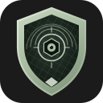
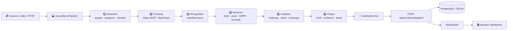
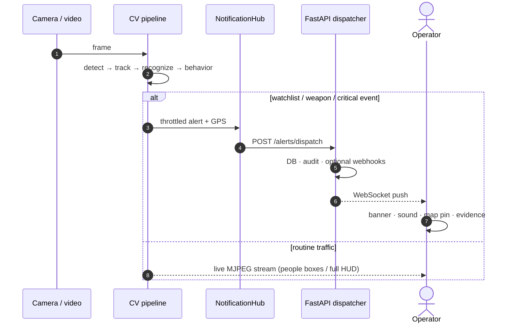
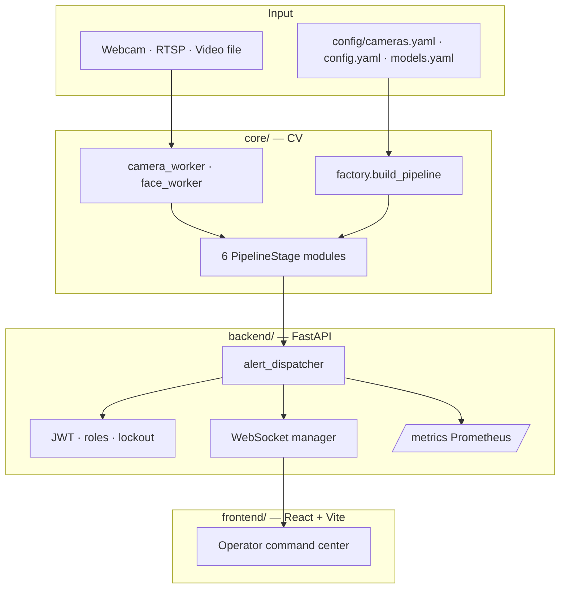
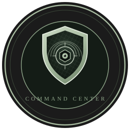

<p align="center">
  
</p>

<h1 align="center">Aegis</h1>

<p align="center"><strong>AI Smart Surveillance System</strong></p>

<p align="center">
  <em>See the threat, pin the place, alert the operators — before the moment passes</em>
</p>

<p align="center">
  
  
  
  
  
  
  
  
</p>

<p align="center">
  Real-time vision pipeline · watchlist face recognition · GPS-tagged multi-channel alerts · capture basket · operator command center
</p>

<p align="center">
  <a href="#-run-it-in-one-command">Quick start</a> ·
  <a href="#-how-it-works">How it works</a> ·
  <a href="#-dashboard-tour">Dashboard tour</a> ·
  <a href="#-brand--identity">Brand</a> ·
  <a href="#-five-minute-demo">Five-minute demo</a> ·
  <a href="#-documents">Docs</a>
</p>

---

> **Why is this hard?** A camera sees everything and tells almost no one. Frames scroll past; a watchlisted face, a weapon, or someone loitering at a gate is easy to miss until it is too late. When something *is* noticed, operators still need the clip, the place, and a usable alert — not a silent log line.
>
> **Aegis answers one question, in real time:** *who (or what) is on this camera right now, should we care, and where exactly is it?*

| 6 staged CV pipeline | Watchlist face match (DB encodings) | GPS on every critical alert | Capture basket | 202 automated tests |
| --- | --- | --- | --- | --- |
| Detect → track → recognize → behave → analyze → output | YuNet + dlib encodings in Postgres / SQLite | Camera lat/lng + Maps link | Zoomed stills every few seconds during a red alert | Unit + integration, CI coverage gate |

---

## The problem and how we answer it

| The problem | What Aegis does | Where to see it |
| --- | --- | --- |
| Cameras produce video, not decisions | A **6-stage pipeline** scores people, vehicles, weapons, faces, and behavior on every frame | Live monitoring · pipeline HUD |
| A match is useless without identity | **Watchlist face recognition** against encodings stored in the database | Watchlist · Face registry |
| Alerts without location waste response time | Every critical event carries **camera GPS** and a Google Maps link | Ops map · critical banner |
| One channel fails, the event is lost | **NotificationHub** fans out to DB, audit log, WebSocket, optional webhooks / SMS | Alert center · audit log |
| Operators need more than a toast | Evidence snapshots, chain-of-custody, incidents, reports, DVR segments | Evidence · Incidents · Reports |
| A red alert without a clear face is hard to act on | **Capture basket** uploads a zoomed still of the subject every few seconds while the alert is live | Capture basket · Live monitoring |
| External freeze / notify must not be silent automation | Watchlist hits can require **operator review** before outbound webhooks | Triage · redispatch |
| Multi-site cameras are messy | Webcam, file, RTSP, and **multi-camera** YAML with env-substituted URLs | Cameras · `config/cameras.yaml` |

**Hero workflow:** a demo clip (or live camera) runs through the pipeline. A watchlisted face is matched; the HUD flashes; the hub posts to the API with GPS; the dashboard plays a sound, shows a red banner, drops a map pin, and stores evidence — while the capture basket fills with zoomed stills and an audit row records who saw what.

---

## How it works

### One frame, start to finish



### What the camera and the operator each see



### Alert types the hub knows how to fire

| Type | Typical trigger | Severity |
| --- | --- | --- |
| `CRIMINAL_DETECTED` | Face match against a watchlisted identity | Critical (review before outbound webhooks) |
| `WEAPON_DETECTED` | Weapon YOLO above threshold | Critical |
| `FIRE_SMOKE_DETECTED` | Fire / smoke detector | Critical |
| `FALL_SUSPECTED` | Pose / fall heuristics | High |
| `SUSPICIOUS_BEHAVIOR` | Loitering, rapid / erratic motion | High |
| `SUSPICIOUS_VEHICLE` | Vehicle + ANPR / rules | High |

---

## Dashboard tour

| Surface | What it does |
| --- | --- |
| **Overview** | System health, model status, cameras online, “needs attention” (missing weapon/vehicle weights, etc.) |
| **Live monitoring** | MJPEG stream from the pipeline (`STREAM_HUD=clean\|full`) with critical banners and browser notifications |
| **Detection / Triage** | Alert queue with severity, camera, GPS, redispatch after human review |
| **Watchlist · Face registry** | Manage identities and encodings; ingest from `data/watchlist/` |
| **Evidence** | Snapshots with optional AES-256-GCM encryption and custody trail |
| **Capture basket** | Zoomed subject stills during critical alerts (`CAPTURE_INTERVAL_SECONDS`); kept only if a critical alert for that camera exists in the last 15 min |
| **Map** | Camera pins and alert geotags (Leaflet) |
| **Cameras · Zone editor** | Registry, GPS, zones / lines for analytics |
| **Vehicles** | Tracks and optional plate OCR (multi-read voting) |
| **Incidents · Reports** | Case-style grouping and incident report API |
| **Analytics** | Occupancy heatmap, dwell, line-crossing in/out |
| **Users · Settings** | JWT roles, retention, stream / DVR / webhook knobs |
| **Copilot · Command palette** | Fast operator shortcuts inside the command center |

---

## Architecture



| Layer | Choice |
| --- | --- |
| Vision | OpenCV, YOLOv8 (+ pose), YuNet face detect, dlib encodings, Deep SORT / ByteTrack, EasyOCR (ANPR) |
| Pipeline | Modular stages in `core/pipeline/stages/`, composition root in `core/app/factory.py` |
| API | FastAPI, SQLAlchemy, Alembic, JWT, AES-256-GCM evidence, optional Redis |
| Dashboard | React 19, Vite 8, Leaflet |
| Ops | `./run.sh`, Make, Docker Compose, GitHub Actions (ruff + pytest coverage gate) |

```
aegis/
├── main.py                 # CLI: single / multi camera, video, headless
├── run.sh                  # one command: API + pipeline + dashboard
├── paths.py                # single source for data/ paths
├── core/                   # detectors, tracking, recognition, analysis, pipeline
├── backend/                # REST, WebSocket, alert dispatcher, auth, services
├── frontend/               # operator UI (pages, hooks, services)
│   └── public/             # logo.svg · logo-seal.svg · logo-lockup.svg · favicon.svg
├── utils/alerts/           # NotificationHub, capture basket, event publisher
├── config/                 # config.yaml, cameras.yaml, models.yaml
├── data/watchlist/         # face images → DB encodings
├── data/demo/clips/        # demo video (sample.mp4)
├── scripts/                # setup, ingest, seed, evaluate, docker-up
├── docs/                   # architecture, defense, development
└── tests/                  # pytest (202 collected)
```

---

## Run it in one command

**Requirements:** Python **3.10–3.12** (not 3.13+), Node 18+, macOS or Linux. Postgres is optional for local demos (`USE_SQLITE=true` by default).

```bash
git clone https://github.com/0xdevabir/aegis-vision.git && cd aegis-vision

./scripts/setup.sh          # first time (or: make setup)
# For a zero-Postgres demo, keep USE_SQLITE=true in .env (default)

cd frontend && npm install && cd ..
# Place a short MP4 at data/demo/clips/sample.mp4 (recommended)

./run.sh                    # or: make run
# ./run.sh path/to/video.mp4
# ./run.sh --no-pipeline    # API + dashboard only
```

Then open **http://localhost:5173** (dashboard) and **http://localhost:8000/docs** (API). The admin password is printed once by setup / `scripts/seed_demo.py` (or set `ADMIN_PASSWORD`).

| Command | Purpose |
| --- | --- |
| `make stop` | Free ports `:8000` and `:5173` |
| `make test` | `pytest tests/unit/ -v` |
| `make backend` / `make pipeline` / `make frontend` | Run each process alone |
| `make ingest` | Re-ingest watchlist faces |
| `make docker-up` | Full stack via Compose (Postgres, Redis, API, pipeline, dashboard) |

### Docker (full stack)

```bash
cp .env.example .env
# Set POSTGRES_PASSWORD, SECRET_KEY, ENCRYPTION_KEY, ENCRYPTION_SALT, INTERNAL_API_KEY
#   python -c "import secrets; print(secrets.token_urlsafe(48))"
docker compose up -d --build
# Dashboard: http://localhost:8080
```

Or one command, which also creates `.env`, the mounted folders and the host webcam bridge:

| OS | Command | Needs |
| --- | --- | --- |
| macOS (Intel / Apple Silicon) | `./scripts/docker-up.sh` or `make docker-up` | Docker Desktop |
| Linux (x86-64 / arm64) | `./scripts/docker-up.sh` or `make docker-up` | Docker Engine + Compose v2 plugin |
| Windows 10/11 | `powershell -ExecutionPolicy Bypass -File scripts\docker-up.ps1` | Docker Desktop (WSL 2 backend) |

- The image is CPU-only and builds natively for amd64 and arm64. Give Docker at least 4 GB of memory (the first build compiles dlib).
- Linux: the containers run as the user who owns `./config`, so files written into the mounts stay yours. The webcam bridge listens on the Docker bridge address (`172.17.0.1:8090`); if a firewall (ufw) is active, allow it: `sudo ufw allow in on docker0 to any port 8090`.
- Windows: clone with Git as usual (`.gitattributes` keeps the shell scripts LF). Run the script from PowerShell, not WSL, if you want the PC's webcam.
- The bridge serves one camera, so every webcam index (`source: 0`, `1`, …) shows the same picture in Docker. Use RTSP/HTTP sources for more cameras.

Host webcam into Docker: `make webcam-bridge` (HTTP bridge on `:8090`). Drop model weights into `./models/` (mounted). Lost admin password: `make docker-admin`.

### Manual (three terminals)

```bash
uvicorn backend.main:app --reload --host 0.0.0.0 --port 8000
python main.py --video data/demo/clips/sample.mp4
cd frontend && npm run dev
```

| Source | Command |
| --- | --- |
| Demo video | `python main.py --video data/demo/clips/sample.mp4` |
| Webcam | `python main.py` |
| Multi-camera RTSP | `python main.py --multi` (edit `config/cameras.yaml`) |
| Headless | `python main.py --multi --no-display` or `HEADLESS=true …` |

**Pipeline keys:** `Q` quit · `S` per-stage stats · `T` thermal overlay.

### Watchlist

```bash
# data/watchlist/CRIMINAL_001_Name/*.jpg
python scripts/convert_heic.py          # if needed
python scripts/ingest_watchlist.py
```

### Troubleshooting

| Symptom | Fix |
| --- | --- |
| `shape_predictor_68_face_landmarks.dat` / `libtorch_cpu` errors | Use `./run.sh` — it always uses `.venv`, not a random system Python |
| Forgot admin password | `python scripts/seed_demo.py --reset-password` |
| Old recordings gone | `DVR_RETENTION_HOURS` (default 48); set `0` to keep |
| Weapon / vehicle “OFF” | Add `models/weapon_yolo.pt` / `models/yolov8l.pt` |
| Alerts not reaching the API | `INTERNAL_API_KEY` must match in `.env` for pipeline and backend |

---

## Five-minute demo

Keep the dashboard open at http://localhost:5173 and the pipeline window visible.

| Time | Beat |
| --- | --- |
| **0:00** | **Problem:** cameras stream; operators still miss the moment. Open Overview — models, cameras, health. |
| **0:30** | **Pipeline:** `./run.sh` (or demo MP4). Point at Detection → Tracking → Recognition stages; press `S` for timings. |
| **1:30** | **Watchlist hit:** a known face matches → HUD “CRIMINAL ALERT”, sound, DB row, audit `AUTO_ALERT`. |
| **2:15** | **Dashboard:** critical banner, browser notification, Events / Triage, map pin with Maps link. |
| **3:00** | **Capture basket:** open the basket — zoomed stills arrive every few seconds while the subject stays in view. |
| **3:30** | **Evidence:** snapshot + custody; show `/api/v1/alerts/` in Swagger if needed. |
| **4:00** | **Trust:** JWT login, roles, review-before-webhook for watchlist hits, append-style audit. |
| **4:40** | **Close:** modular CV + operator loop — detect, locate, alert, review — not a silent DVR. |

Full talking points and viva backup: [`docs/DEFENSE.md`](docs/DEFENSE.md).

```bash
python scripts/evaluate_pipeline.py \
  --video data/demo/clips/sample.mp4 \
  --frames 200 \
  --output data/results/eval.json
```

---

## Configuration

Copy `.env.example` → `.env`. Important variables:

| Variable | Role |
| --- | --- |
| `DATABASE_URL` / `USE_SQLITE` | Postgres or local SQLite demo |
| `SECRET_KEY` | JWT signing |
| `ENCRYPTION_KEY` + `ENCRYPTION_SALT` | AES-256-GCM evidence (both required; no silent default) |
| `INTERNAL_API_KEY` | Pipeline ↔ backend (must match) |
| `BACKEND_URL` | Where the pipeline posts events |
| `WEBHOOK_SIGNING_SECRET` | `X-Aegis-Signature: sha256=HMAC(…)` on outbound webhooks |
| `METRICS_TOKEN` | Bearer for Prometheus `/api/v1/metrics` |
| `STREAM_*` / `DVR_*` | Live MJPEG quality and continuous recording retention |
| `CAPTURE_ENABLED` / `CAPTURE_INTERVAL_SECONDS` / `CAPTURE_RETENTION_DAYS` | Red-alert capture basket (zoomed stills while a critical subject is in view) |
| Camera GPS | `config/cameras.yaml` or `config/config.yaml` → `camera_lat` / `camera_lng` |

| File | Purpose |
| --- | --- |
| `config/config.yaml` | Thresholds, behavior, default GPS, device |
| `config/cameras.yaml` | Multi-cam RTSP / indexes (`${RTSP_GATE_1}` from `.env`) |
| `config/models.yaml` | Model paths, face tolerance, OCR languages |

**Model weights** under `models/` (examples): `yolov8s.pt` (people), `yolov8n-pose.pt`, `weapon_yolo.pt`, `yolov8l.pt` (vehicles), `face_detection_yunet_2023mar.onnx` (fetched by `ensure_local_env.py`).

---

## API overview

All routes under `/api/v1/`. Interactive docs: http://localhost:8000/docs

| Area | Examples |
| --- | --- |
| Auth | `POST /auth/login` |
| Alerts | `POST /alerts/dispatch` (internal), list / redispatch / triage |
| Cameras · Map | `GET /cameras`, `GET /map/cameras` |
| Evidence · Custody | evidence upload/list, chain-of-custody |
| Captures | `POST /captures/ingest` (pipeline), list / fetch basket stills |
| Faces · Watchlist | registry CRUD, ingest-backed encodings |
| Reports · Incidents | `GET /reports/incident`, incident workflows |
| Stream · VMS · DVR | live MJPEG, recordings, retention |
| System · Metrics | status heartbeat, Prometheus text |

---

## Trust and limits

Guardrails that matter in a surveillance system:

| Guardrail | How it shows up |
| --- | --- |
| AuthN / AuthZ | JWT, role checks, login lockout, rate limiting |
| Audit | Auto-alerts and sensitive actions written to `audit_logs` |
| Review before blast radius | `CRIMINAL_DETECTED` can require operator review before external webhooks |
| Evidence integrity | Snapshots + optional encryption; custody service |
| Secrets | No baked-in production keys; `.env.example` documents required values |
| Face process isolation | Face workers run out-of-process by default (dlib + PyTorch/MPS in one process can segfault) |

**Stated plainly — what this is not:**

- **A thesis / prototype platform**, not a certified physical-security product. Multi-camera is a threaded single-node design; Redis is optional HA scaffolding, not a full bus yet.
- **Detection quality depends on your models, lighting, and camera angle.** Thresholds in YAML must be tuned; false positives are expected and throttled, not eliminated.
- **Watchlist matching is only as good as the enrolled faces.** Privacy: match enrolled identities; keep retention and external webhooks off until you intend them.
- **Browser live view is MJPEG from the pipeline**, not a full VMS client; production browser fan-out may need a dedicated media path.

---


## Brand & identity

Official marks live under `frontend/public/`. Use the system logo on the command center, docs, and government briefs; keep clear space around the shield equal to the aperture diameter.

| Asset | File | Use |
| --- | --- | --- |
| **System logo** | [`frontend/public/logo.svg`](frontend/public/logo.svg) | App chrome, login, sidebar, PWA |
| **Favicon** | [`frontend/public/favicon.svg`](frontend/public/favicon.svg) | Browser tab |
| **Official seal** | [`frontend/public/logo-seal.svg`](frontend/public/logo-seal.svg) | Letterhead, reports, presentations |
| **Wordmark lockup** | [`frontend/public/logo-lockup.svg`](frontend/public/logo-lockup.svg) | README, docs headers, slide titles |

**Mark language:** heraldic shield (protection) · hexagonal camera aperture (sensor) · radar arcs + reticle (coverage / precision) · diagonal lattice (structured monitoring). Palette: sage `#a8bca1` on charcoal `#1b1b1b`.

<p align="center">
  
  &nbsp;&nbsp;&nbsp;
  
</p>

## Documents

| Document | Description |
| --- | --- |
| [`docs/ARCHITECTURE.md`](docs/ARCHITECTURE.md) | Layout, data flow, stage list, alert path |
| [`docs/DEFENSE.md`](docs/DEFENSE.md) | Graduation demo script, backups, viva Q&A |
| [`docs/DEVELOPMENT.md`](docs/DEVELOPMENT.md) | Developer setup and conventions |
| [`AGENTS.md`](AGENTS.md) | Contributor / coding-agent quick reference |
| [`.env.example`](.env.example) | Every environment knob |

---

## Impact

- **Operators:** one place for live video, ranked alerts, map context, capture stills, and evidence — not three tools and a radio delay.
- **Security teams:** watchlist and weapon events land with GPS and an audit trail, with human review before irreversible outbound notify.
- **Builders / researchers:** a modular CV pipeline you can time, extend, and evaluate (`evaluate_pipeline.py`) beside a real FastAPI + React command center.

---

## Contributing

Issues and pull requests are welcome. Run `make test` (and keep `INTERNAL_API_KEY` consistent) before you push. CI: `.github/workflows/ci.yml`.

## License

Academic / project use — see the repository owner for terms.

---

*Aegis: the camera already saw it — make sure the right people do too.*
